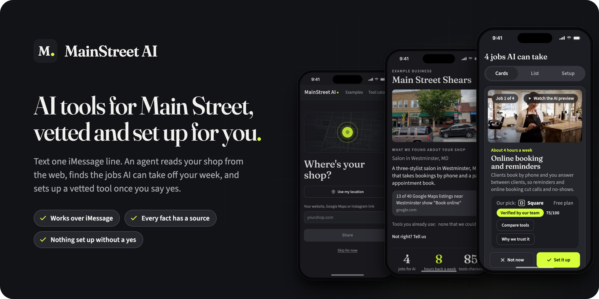

<p align="center">
  <a href="https://mainstreet-ai-five.vercel.app"></a>
</p>

<p align="center">
  <a href="https://mainstreet-ai-five.vercel.app"><strong>Try the prototype</strong></a>
  &nbsp;&middot;&nbsp;
  <a href="#how-it-works"><strong>How it works</strong></a>
  &nbsp;&middot;&nbsp;
  <a href="#preview-videos"><strong>Preview videos</strong></a>
  &nbsp;&middot;&nbsp;
  <a href="#the-market"><strong>The market</strong></a>
  &nbsp;&middot;&nbsp;
  <a href="#run-it"><strong>Run it</strong></a>
</p>

<p align="center">
  <a href="https://mainstreet-ai-five.vercel.app"></a>
  
  
  
  
  
  
</p>

<br>

MainStreet AI helps Main Street small businesses (diners, coffee shops, small HVAC firms, landscapers, salons) find AI tools they can trust and get them set up. An owner texts an iMessage line or uses the website: it is the same assistant, the same shop and the same answers either way. An agent reads their shop from the web and finds the jobs AI can take off their week. It picks a vetted tool for each job and sets it up once the owner approves.

Built by Team Forge for the UMD AI for Small Business Hack-a-thon, Fall 2026.

## Two doors, one assistant

<a href="docs/assets/two-doors.jpg"></a>

Both doors, then the five steps an owner goes through: what we found, why we trust the pick, the tool at work, yes or no, and the setup. Nothing happens until the owner says yes.

## How it works

<picture>
  <source media="(prefers-color-scheme: dark)" srcset="docs/assets/how-it-works-dark.png">
  
</picture>

Under the hood:

- **iMessage** (`imessage/`) relays texts to the API. Replies come back as up to 3 short texts plus native iMessage UI: the owner's plan as an app card with a photo of their street, iMessage's own "share your location" request in place of the share page, and a yes/no poll when the agent asks to set up a tool. A vote on the poll approves or declines the setup, the same as the buttons on the page.
- **Two doors, one shop.** A shop started on the website shows a short shop code under "Rather text?". Texting it to the line (+1 415 225 0168) ties that phone to the same shop, and from then on a yes, a step that needs the owner, or a finished setup on the website is texted to the phone too. A shop started by text has its page one tap away on the plan card.
- **Each turn runs in a sandbox.** The API (`msapi`) runs Claude Code in a Docker container with three tools: `tf fetch` (TinyFish) reads the shop's link and the nearby map listings, `ws` saves records, and `match` checks needs against the vetted catalog.
- **Every fact has a source.** The profile holds 3 to 5 short facts, each linked to its page, for example *13 of 40 Google Maps listings near Westminster show "Book online"*.
- **Nothing is set up without a yes.** Each job gets one vetted pick with a trust score, and setup waits for the owner's approval. "Not now" answers at once and can still become a yes later, on either door.

The chart's source is [`docs/assets/how-it-works.excalidraw`](docs/assets/how-it-works.excalidraw); open it at excalidraw.com to edit.

## Preview videos

Before saying yes, the owner can see the tool at work in a shop like theirs. The agent writes one scene from the shop's profile, and the `preview` tool renders it as a 6-second clip with Google Veo 3.1 Lite through OpenRouter's video API (720p, no audio, about $0.05 a second). The clip plays on the job card, labelled "AI-generated preview", and arrives inline in iMessage.

<p align="center">
  
</p>

## The market

<a href="docs/assets/market.jpg"></a>

| | Who | How many | Source |
|---|---|---|---|
| TAM | Every U.S. small business | 36.2M | SBA Office of Advocacy, Feb 2026 |
| SAM | U.S. small businesses not using AI yet (36.2M x 80.2%) | 29.0M | Census BTOS, May 2026 |
| SOM | Maryland small businesses not using AI yet (696,710 x 80.2%) | 559K | SBA Advocacy, Maryland profile 2025 |

Only 19.8% of U.S. businesses used AI in the past two weeks (Census BTOS, May 2026), and 22% of firms not planning to use it don't know what it can do (Census CES WP 26-25). The biggest directory lists 50,000+ tools and makers pay to be seen there. Our catalog is 85 tools a person approved (261 found, 207 read, 109 scored), with no paid placement. Each pick carries a trust score instead of star ratings: six checks, each linked to evidence (who's behind it, age, data handling, public prices, independent reviews, still shipping), and 75 out of 100 or more plus a person's sign-off makes it Verified. "Still shipping" is there because tools do vanish: Relay.app shut down and deleted all its workflows in August 2026.

## Layout

| Path | What it is |
|---|---|
| `web/` | Next.js app on Vercel: share page, owner page, compare, preview, setup; static catalog and demo businesses |
| `api/` | FastAPI (`msapi`): owner workspaces, sandboxed agent turns, approvals, iMessage endpoint |
| `sandbox/` | Docker image the agent runs in: Claude Code with a fixed `settings.json`, `CLAUDE.md`, skills, and the tool CLIs in `sandbox/tools` (`mstools`) |
| `catalog/` | Offline pipeline (`mscatalog`): discover, read, extract, vet, human review, export `catalog.json` |
| `demo-sites/` | Five fictional Maryland business websites |
| `imessage/` | Photon relay from iMessage to the API |
| `scripts/` | `live.sh` (tunnel, deploy, relay) and `prerun_demos.py` |
| `docs/assets/brand/` | Logo: app icon, wordmarks for light and dark backgrounds, and the banner above (1280 x 640, also the repo's social preview). `node docs/assets/brand/src/render.mjs` rebuilds them from `src/brand.html` |

## Run it

```bash
uv sync
uv run pytest                          # Python tests
cd web && pnpm exec playwright test    # web tests
./scripts/live.sh                      # API + Cloudflare tunnel + Vercel env + iMessage relay
./scripts/live.sh stop
```

Keys come from the macOS Keychain: `TINYFISH_API_KEY`, `OPENROUTER_API_KEY`, `AGENTMAIL_API_KEY`, `AISB_CLAUDE_OAUTH`.

<br>

<p align="center">
  <picture>
    <source media="(prefers-color-scheme: dark)" srcset="docs/assets/brand/wordmark-dark.png">
    
  </picture>
  <br>
  <sub>Team Forge &middot; UMD AI for Small Business Hack-a-thon, Fall 2026</sub>
</p>
