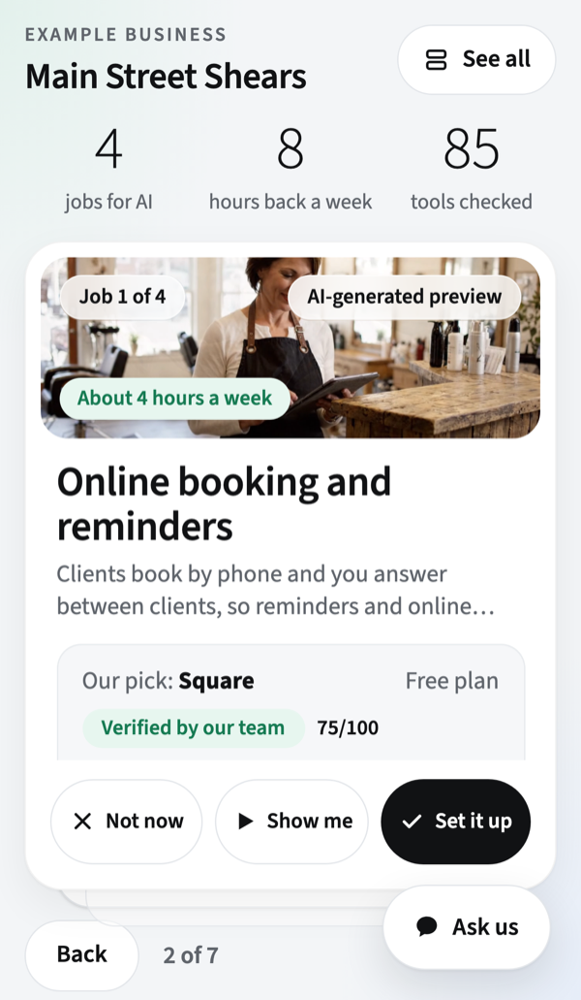
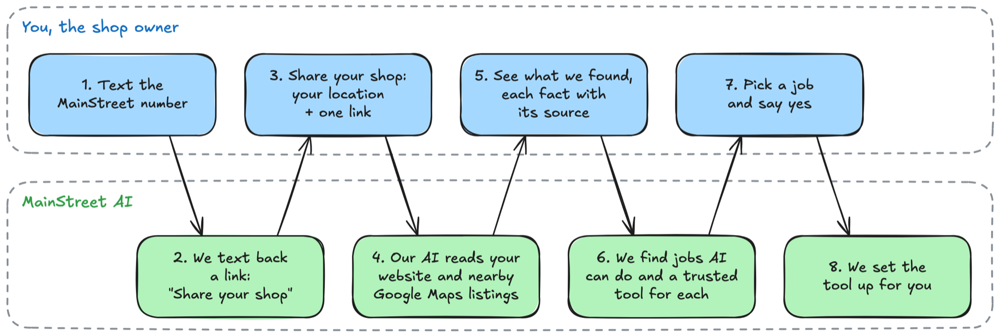

# MainStreet AI

MainStreet AI helps Main Street small businesses (diners, coffee shops, small HVAC firms, landscapers, salons) find AI tools they can trust and get them set up. An owner texts an iMessage line. An agent reads their shop from the web and finds the jobs AI can take off their week. It picks a vetted tool for each job and sets it up once the owner approves.

Built for the UMD AI for Small Business Hack-a-thon, Fall 2026.

<p align="center">
  
  
  
</p>

## How it works

<picture>
  <source media="(prefers-color-scheme: dark)" srcset="docs/assets/how-it-works-dark.png">
  
</picture>

Under the hood:

- **iMessage** (`imessage/`) relays texts to the API. Replies come back as up to 3 short texts plus a link card.
- **Each turn runs in a sandbox.** The API (`msapi`) runs Claude Code in a Docker container with three tools: `tf fetch` (TinyFish) reads the shop's link and the nearby map listings, `ws` saves records, and `match` checks needs against the vetted catalog.
- **Every fact has a source.** The profile holds 3 to 5 short facts, each linked to its page, for example *13 of 40 Google Maps listings near Westminster show "Book online"*.
- **Nothing is set up without a yes.** Each job gets one vetted pick with a trust score, and setup waits for the owner's approval.

The chart's source is [`docs/assets/how-it-works.excalidraw`](docs/assets/how-it-works.excalidraw); open it at excalidraw.com to edit.

## Layout

| Path | What it is |
|---|---|
| `web/` | Next.js app on Vercel: share page, owner page, compare, preview, setup; static catalog and demo businesses |
| `api/` | FastAPI (`msapi`): owner workspaces, sandboxed agent turns, approvals, iMessage endpoint |
| `sandbox/` | Docker image the agent runs in: Claude Code with a fixed `settings.json`, `CLAUDE.md`, skills, and the tool CLIs in `sandbox/tools` (`mstools`) |
| `catalog/` | Offline pipeline (`mscatalog`): discover, read, extract, vet, human review, export `catalog.json` |
| `demo-sites/` | Five fictional Maryland business websites |
| `imessage/` | Photon relay from iMessage to the API |
| `scripts/` | `live.sh` (tunnel, deploy, relay) and `prerun_demos.py` |

It grew out of Loopcast, a TinyFish GTM app ([tiny-fish-gtm-automation](https://github.com/IshaanKalra2103/tiny-fish-gtm-automation)).

## Run it

```bash
uv sync
uv run pytest                          # Python tests
cd web && pnpm exec playwright test    # web tests
./scripts/live.sh                      # API + Cloudflare tunnel + Vercel env + iMessage relay
./scripts/live.sh stop
```

Keys come from the macOS Keychain: `TINYFISH_API_KEY`, `OPENROUTER_API_KEY`, `AGENTMAIL_API_KEY`, `AISB_CLAUDE_OAUTH`.
