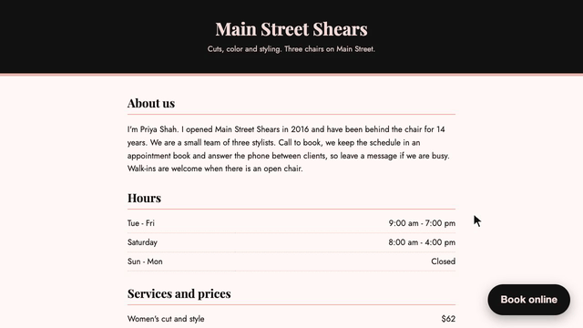

<p align="center">
  <a href="https://mainstreet-ai-five.vercel.app"></a>
</p>

<p align="center">
  <a href="https://mainstreet-ai-five.vercel.app"><strong>Try the prototype</strong></a>
  &nbsp;&middot;&nbsp;
  <a href="#how-it-works"><strong>How it works</strong></a>
  &nbsp;&middot;&nbsp;
  <a href="#preview-videos"><strong>Preview videos</strong></a>
  &nbsp;&middot;&nbsp;
  <a href="#the-market"><strong>The market</strong></a>
  &nbsp;&middot;&nbsp;
  <a href="#run-it"><strong>Run it</strong></a>
</p>

<p align="center">
  <a href="https://mainstreet-ai-five.vercel.app"></a>
  
  
  
  
  
  
</p>

<br>

MainStreet AI helps Main Street small businesses (diners, coffee shops, small HVAC firms, landscapers, salons) find AI tools they can trust and get them set up. An owner texts an iMessage line or uses the website: it is the same assistant, the same shop and the same answers either way. An agent reads their shop from the web and finds the jobs AI can take off their week. It picks a vetted tool for each job and sets it up once the owner approves.

Built by Team Forge for the UMD AI for Small Business Hack-a-thon, Fall 2026.

## Two doors, one assistant

<a href="docs/assets/two-doors.jpg"></a>

Both doors, then the six steps an owner goes through: what we found, why we trust the pick, yes or no, the setup, the result, and a preview of the tool at work. Nothing happens until the owner says yes.

## How it works

<picture>
  <source media="(prefers-color-scheme: dark)" srcset="docs/assets/how-it-works-dark.png">
  
</picture>

Under the hood:

- **iMessage** (`imessage/`) relays texts to the API. Replies come back as up to 3 short texts plus native iMessage UI: the owner's plan as an app card with a photo of their street, iMessage's own "share your location" request in place of the share page, and a yes/no poll when the agent asks to set up a tool. A vote on the poll approves or declines the setup, the same as the buttons on the page.
- **Two doors, one shop.** A shop started on the website shows a short shop code under "Rather text?". Texting it to the line (+1 415 225 0168) ties that phone to the same shop, and from then on a yes, a step that needs the owner, or a finished setup on the website is texted to the phone too. A shop started by text has its page one tap away on the plan card.
- **Each turn runs in a sandbox.** The API (`msapi`) runs Claude Code in a Docker container with three tools: `tf fetch` (TinyFish) reads the shop's link and the nearby map listings, `ws` saves records, and `match` checks needs against the vetted catalog.
- **Every fact has a source.** The profile holds 3 to 5 short facts, each linked to its page, for example *13 of 40 Google Maps listings near Westminster show "Book online"*.
- **Nothing is set up without a yes.** Each job gets one vetted pick with a trust score, and setup waits for the owner's approval. "Not now" answers at once and can still become a yes later, on either door.

The chart's source is [`docs/assets/how-it-works.excalidraw`](docs/assets/how-it-works.excalidraw); open it at excalidraw.com to edit.

## Preview videos

The last step. Once the tool is set up, the owner gets a short look at the tool at work for their shop. A preview comes in one of two kinds; both of these are Square at the same salon, Main Street Shears.

<table>
  <tr>
    <th width="50%">In the shop</th>
    <th width="50%">On the shop's website</th>
  </tr>
  <tr>
    <td></td>
    <td></td>
  </tr>
  <tr>
    <td>A client books a haircut on her phone at night. Next morning the owner sees the day's schedule on a tablet at the front desk.</td>
    <td>A customer opens Book online on the shop's own page, picks a cut for Saturday at 10:30 and gets the booking confirmed.</td>
  </tr>
</table>

- **In the shop.** The agent writes one scene from the shop's profile, and `preview make` renders it with Google Veo 3.1 Lite through OpenRouter's video API (720p, no audio, about $0.05 a second). It is labelled "AI-generated preview".
- **On the shop's website.** The agent reads the shop's homepage in a cloud browser and rebuilds it as one page with the tool added, using the shop's real words. `preview record` then films the tool working there in a Browser Use browser: the cursor opens the tool, the customer's request goes in, and the answer comes back. The recording costs nothing in video credits.

Either kind plays on the shop's page and arrives inline in iMessage. An owner can also ask for one on any job before saying yes.

## The market

<a href="docs/assets/market.jpg"></a>

| | Who | How many | Source |
|---|---|---|---|
| TAM | U.S. small businesses with employees (36.2M counting solo businesses) | 6.4M | SBA Advocacy, Census, 2026 |
| SAM | Yearly AI-tool spend Main Street could route through one trusted assistant (6.4M x 2 tools x $30-79 a month) | $4.5-12B | Our estimate |
| SOM | Maryland small businesses not using AI yet (696,710 x 80.2%) | 559K | SBA Advocacy, Maryland profile 2025; Census BTOS, May 2026 |

Only 19.8% of U.S. businesses used AI in the past two weeks (Census BTOS, May 2026). The playbook is OpenRouter's: one door to 400+ AI models for about the same 5% fee on any model, then a $7B+ Stripe deal in August 2026. We do that for Main Street's AI tools. Of 261 tools found, a person approved 85 and 19 earn Verified, and no maker can pay for placement. Verified is a trust score, not a star rating: six checks, each linked to evidence (who's behind it, age, data handling, public prices, independent reviews, still shipping), plus a person's sign-off. Policy tailwind: H.R. 5764 passed 395-14 on January 20, 2026 and is pending in the Senate.

## Layout

| Path | What it is |
|---|---|
| `web/` | Next.js app on Vercel: share page, owner page, compare, preview, setup; static catalog and demo businesses |
| `api/` | FastAPI (`msapi`): owner workspaces, sandboxed agent turns, approvals, iMessage endpoint |
| `sandbox/` | Docker image the agent runs in: Claude Code with a fixed `settings.json`, `CLAUDE.md`, skills, and the tool CLIs in `sandbox/tools` (`mstools`) |
| `catalog/` | Offline pipeline (`mscatalog`): discover, read, extract, vet, human review, export `catalog.json` |
| `demo-sites/` | Five fictional Maryland business websites |
| `imessage/` | Photon relay from iMessage to the API |
| `scripts/` | `live.sh` (tunnel, deploy, relay) and `prerun_demos.py` |
| `docs/assets/brand/` | Logo: app icon, wordmarks for light and dark backgrounds, and the banner above (1280 x 640, also the repo's social preview). `node docs/assets/brand/src/render.mjs` rebuilds them from `src/brand.html` |

## Run it

```bash
uv sync
uv run pytest                          # Python tests
cd web && pnpm exec playwright test    # web tests
./scripts/live.sh                      # API + Cloudflare tunnel + Vercel env + iMessage relay
./scripts/live.sh stop
```

Keys come from the macOS Keychain: `TINYFISH_API_KEY`, `OPENROUTER_API_KEY`, `AGENTMAIL_API_KEY`, `AISB_CLAUDE_OAUTH`.

<br>

<p align="center">
  
  <br>
  <sub>Team Forge &middot; UMD AI for Small Business Hack-a-thon, Fall 2026</sub>
</p>
