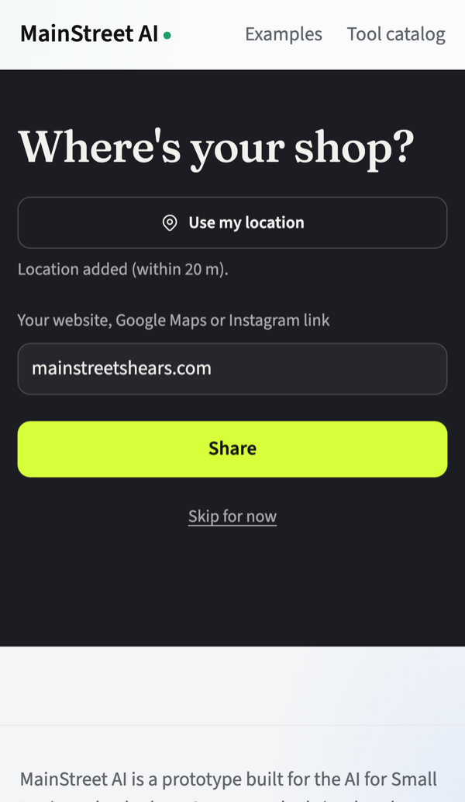
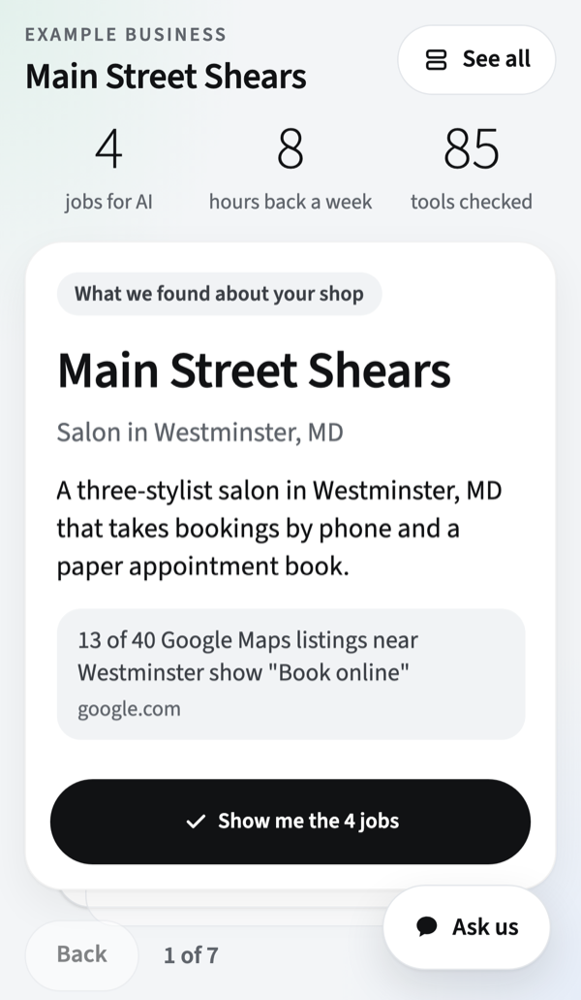
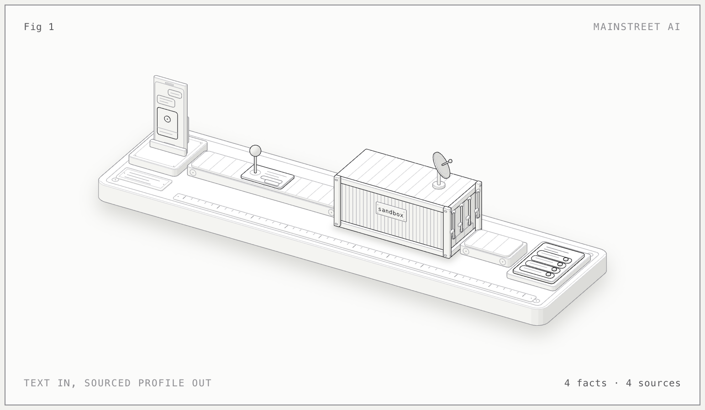

# MainStreet AI

MainStreet AI helps Main Street small businesses (diners, coffee shops, small HVAC firms, landscapers, salons) find AI tools they can trust and get them set up. An owner texts an iMessage line. An agent reads their shop from the web and finds the jobs AI can take off their week. It picks a vetted tool for each job and sets it up once the owner approves.

Built for the UMD AI for Small Business Hack-a-thon, Fall 2026.

<p align="center">
  
  
  
</p>

## How it works

<picture>
  <source media="(prefers-color-scheme: dark)" srcset="docs/assets/workflow-dark.png">
  
</picture>

1. **Text the line.** The owner texts the iMessage number. Replies come back as up to 3 short texts plus a link card. Until the agent knows the shop, the card opens the share page.
2. **Share your shop.** `/b/<id>/shop` takes one tap for location and one link (website, Google Maps or Instagram), sent to the agent as one message.
3. **Sandboxed agent.** The API (`msapi`) runs each turn as Claude Code inside a Docker container. Its tools: `tf fetch` (TinyFish) reads the link and the nearby map listings, `ws` saves records, and `match` checks the owner's needs against the vetted catalog.
4. **Profile with sources.** The agent saves 3 to 5 short facts, each linked to the page it came from, for example *13 of 40 Google Maps listings near Westminster show "Book online"*.
5. **Jobs for AI.** Each job gets one vetted pick with a trust score. The agent sets it up only after the owner approves.

## Layout

| Path | What it is |
|---|---|
| `web/` | Next.js app on Vercel: share page, owner page, compare, preview, setup; static catalog and demo businesses |
| `api/` | FastAPI (`msapi`): owner workspaces, sandboxed agent turns, approvals, iMessage endpoint |
| `sandbox/` | Docker image the agent runs in: Claude Code with a fixed `settings.json`, `CLAUDE.md`, skills, and the tool CLIs in `sandbox/tools` (`mstools`) |
| `catalog/` | Offline pipeline (`mscatalog`): discover, read, extract, vet, human review, export `catalog.json` |
| `demo-sites/` | Five fictional Maryland business websites |
| `imessage/` | Photon relay from iMessage to the API |
| `scripts/` | `live.sh` (tunnel, deploy, relay) and `prerun_demos.py` |

This is branch `aisb`. Loopcast, the TinyFish GTM app it grew from, is on `main`.

## Run it

```bash
uv sync
uv run pytest                          # Python tests
cd web && pnpm exec playwright test    # web tests
./scripts/live.sh                      # API + Cloudflare tunnel + Vercel env + iMessage relay
./scripts/live.sh stop
```

Keys come from the macOS Keychain: `TINYFISH_API_KEY`, `OPENROUTER_API_KEY`, `AGENTMAIL_API_KEY`, `AISB_CLAUDE_OAUTH`.
